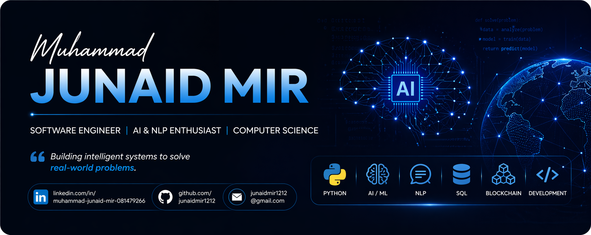

<!-- ========================= BANNER ========================= -->

  

<!-- ========================= NAME / INTRO ========================= -->
<h1 align="center">Muhammad Junaid Mir</h1>
<h3 align="center">BSc (Hons) Computer Science Graduate (UK) | AI & NLP | Python, Machine Learning, .NET | Open to Graduate Roles And Collaborations</h3>

  

---

## 🌐 Live Portfolio

**Explore my full work here:**  
🔗 [Portfolio](https://muhammadjuniadmir.vercel.app/)

---

## 👉 Socials

  
  
  
  

---

## ⚡ About Me

I am a **BSc (Hons) Computer Science Graduate (UK)** with strong interests in **software engineering, artificial intelligence, natural language processing, backend systems, and full-stack development**. I enjoy building practical, real-world solutions that combine technical depth with usability.

- 🎓 BSc (Hons) Computer Science Graduate
- 🤖 Focused on **AI, NLP, software development, backend systems, and intelligent applications**
- 🧠 Built a fake news detection project using **machine learning and NLP**
- 🔗 Developed a **blockchain-based event ticketing DApp**
- 💻 Built full-stack, database-driven, and portfolio-based software projects
- 💼 Actively seeking **Graduate Software Engineer / AI / Backend roles in the UK**
- 🌐 Portfolio: [Portfolio](https://muhammadjuniadmir.vercel.app/)

---

## 💻 Tech Stack

### 🚀 Languages
         

### 🧠 AI / Data Science / NLP
        

### 🌐 Full-Stack & Frameworks
         

### 🗄️ Databases & Caching
        

### ☁️ Cloud & DevOps
         

### 🛠 Tools & Design
       

---

## 🚀 Featured Projects

### 🫀 ECG Arrhythmia Classification

**Repository:**  
[ECG Arrhythmia Classification](https://github.com/junaidmir1212/ECG-Arrhythmia-Classification.git)

**Live Project:**  
[ECG Arrhythmia Classification](https://ecg-arrhythmia-diagnostics.streamlit.app/)

**Overview**  
Developed an edge-optimized continuous ECG arrhythmia classification application featuring synthetic signal ingestion and automated clinical audit reporting designed for real-time healthcare monitoring.

**Key Highlights**
- Implemented edge-optimized classification for real-time ECG signal processing
- Integrated synthetic signal ingestion pipelines for robust model testing
- Generated automated clinical audit reports for diagnostic review
- Designed with a problem-first philosophy combining healthcare utility with software reliability

**Tech Stack**  

### 🔍 Fake News Detection on Social Media Using NLP

**Repository:**  
[Fake News Detection on Social Media Using Natural Language Processing NLP](https://github.com/junaidmir1212/Fake-News-Detection-on-Social-Media-Using-Natural-Language-Processing-NLP.git)

**Overview**  
Developed a machine learning-based system to classify social media/news content as **real or fake** using Natural Language Processing techniques.

**Key Highlights**
- Performed text preprocessing including tokenisation, stopword removal, and TF-IDF vectorisation
- Applied machine learning models such as **Naive Bayes** and **Logistic Regression**
- Built a practical AI solution targeting misinformation detection
- Achieved approximately **98% classification accuracy**

**Tech Stack**  

---

### 🎟️ Event Ticketing DApp

**Repository:**  
[Event Ticketing D-App](https://github.com/junaidmir1212/Event-Ticketing-D-App.git)

**Overview**  
Built a blockchain-based decentralised ticketing system designed to reduce ticket fraud, duplication, and lack of transparency in traditional ticketing platforms.

**Key Highlights**
- Used smart-contract-based logic for ticket issuance and validation
- Designed a ticketing model where each ticket is uniquely verifiable
- Applied NFT-based validation concepts to improve authenticity
- Demonstrated a practical **Web3** use case for event systems

**Tech Stack**  

---

### 🎓 Graduate Career Hub

**Repository:**  
[Graduate Career Hub](https://github.com/junaidmir1212/graduate-career-hub.git)

**Live Project:**  
[Graduate Career Hub](https://graduate-career-hub.vercel.app/)

**Overview**  
Built a full-stack graduate career platform to help students organise applications, track career progress, and manage employability-related information in one place.

**Key Highlights**
- Developed a modern web application using **Next.js**
- Integrated backend/database functionality using **Prisma**
- Designed dashboard-style pages for career and project management
- Deployed the application using **Vercel**
- Focused on practical employability support for graduates

**Tech Stack**  

---

### 💻 Chopstix OS

**Repository:**  
[Chopstix OS](https://github.com/junaidmir1212/Chopstix-OS.git)

**Live Project:**  
[Chopstix OS](https://chopstix-os.vercel.app/)

**Overview**  
Developed a custom x86 operating system kernel from the ground up, implementing core low-level functionalities and hardware abstraction layers to understand the "roots" of computing.

**Key Highlights**
*   Built a kernel capable of managing hardware resources and providing essential system services.
*   Implemented custom Memory Segmentation and Global Descriptor Tables (GDT) to manage system memory safely.
*   Developed Interrupt Descriptor Tables (IDT) and handled hardware interrupts for keyboard input and system timers.
*   Programmed low-level VGA drivers for text-mode display and keyboard drivers for user interaction.
*   Utilised QEMU and GDB for rigorous testing and debugging of low-level Assembly and C code.

**Tech Stack**  

---

### 🗄️ Database-Driven Application / SQL System

**Overview**  
Designed and implemented a relational database system focused on structured data management, efficient querying, and data integrity.

**Key Highlights**
- Designed relational tables for organised data storage
- Developed SQL queries for retrieval, filtering, insertion, and updates
- Applied normalisation principles to reduce redundancy
- Improved data consistency through structured database design
- Demonstrated backend/database fundamentals for real-world systems

**Tech Stack**  

---

### 🌐 Personal Portfolio Website

**Repository:**  
[Portfolio](https://github.com/junaidmir1212/junaid-portfolio.git)

**Live Project:** 
 [Portfolio](https://muhammadjuniadmir.vercel.app/) 

**Overview**  
Designed and deployed a modern personal portfolio website to showcase my technical projects, skills, CV, and career focus.

**Key Highlights**
- Built a responsive portfolio using **Next.js and React**
- Showcased AI, NLP, blockchain, and database projects
- Added downloadable CV and professional contact links
- Improved project presentation with case-study style sections
- Deployed live using **Vercel**

**Tech Stack**  

---

## 📌 What Sets Me Apart

- Strong balance of **academic foundations and hands-on project work**
- Comfortable building **end-to-end systems**
- Interested in both **intelligent systems** and **practical software solutions**
- Focused on projects with clear real-world value
- Motivated to keep learning and contribute in professional engineering environments

---

## 📊 GitHub Analytics

  

---

## 🎯 Career Focus

I am currently targeting opportunities in:

- Graduate **Software Engineering**
- **Artificial Intelligence / Machine Learning**
- **Backend Development**
- Systems and application development roles

---

## 🤝 Connect With Me

  
  

---

## ✍️ Personal Philosophy

Strong engineers do not just build software — they solve meaningful problems with clarity, logic, and impact.
